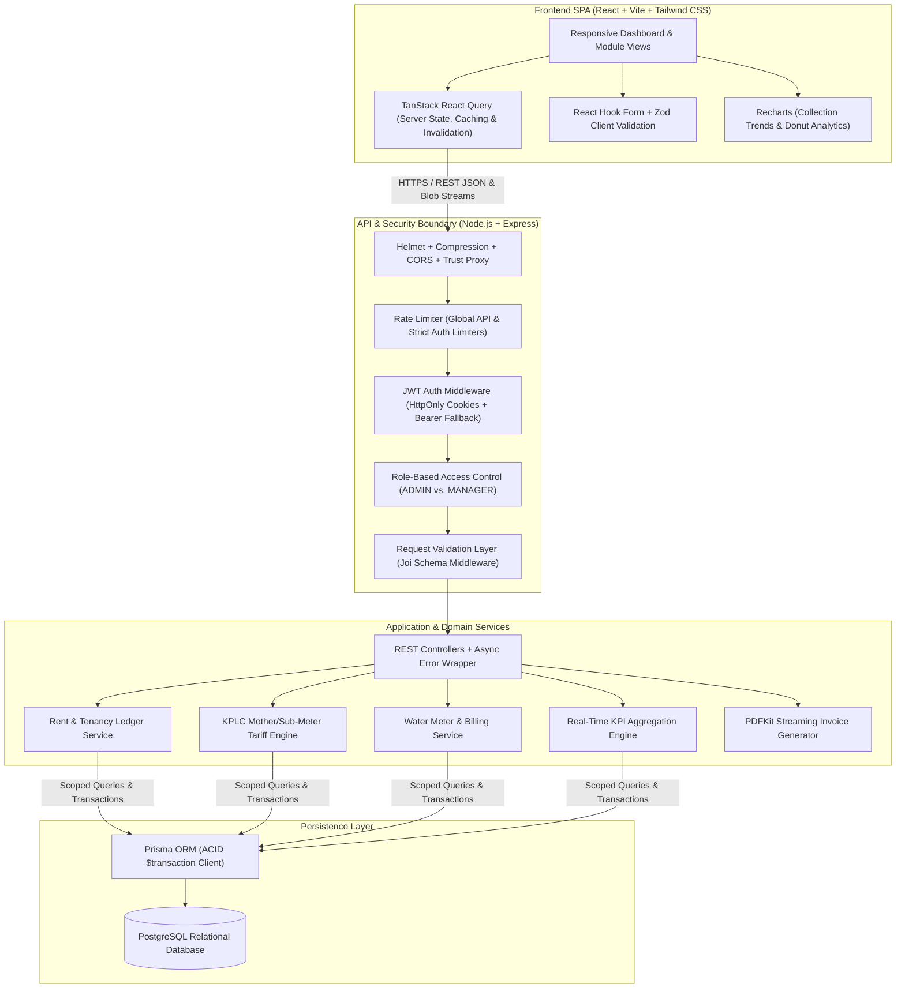
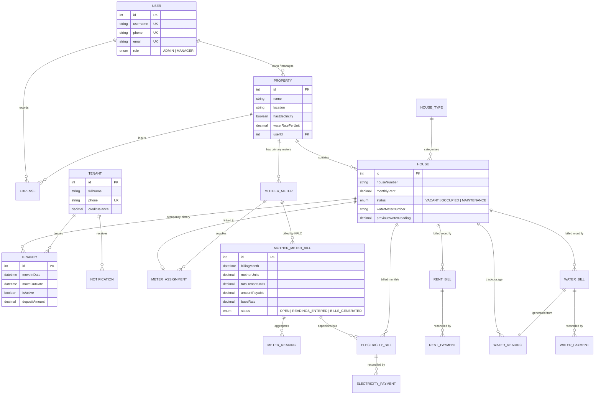
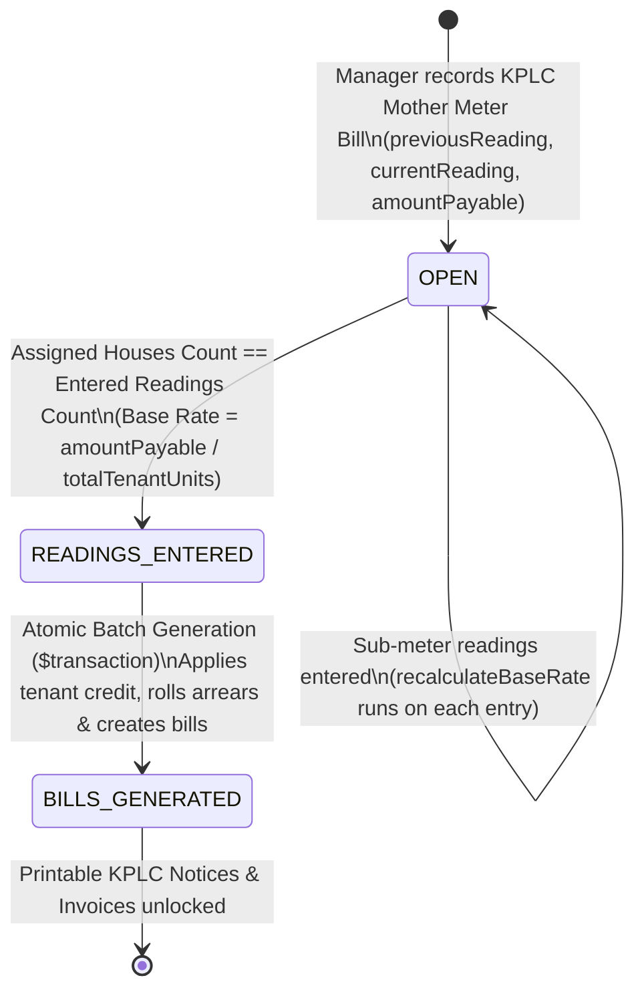

  <h1>🏢 NyumbaFlow (Miliqo)</h1>
  
<strong>Property & Utility Billing Management System for the East African Rental Market</strong>

  

    
    
    
    
    
    
  

  

    <a href="#-executive-summary">Executive Summary</a> •
    <a href="#-the-everyday-problem">Everyday Problem</a> •
    <a href="#-what-nyumbaflow-does">What It Does</a> •
    <a href="#-how-it-works">Workflow</a> •
    <a href="#-system-architecture">Architecture</a> •
    <a href="#-database-schema-erd">Database Design</a> •
    <a href="#-core-engineering-highlights">Engineering Highlights</a> •
    <a href="#-feature-modules">Modules</a> •
    <a href="#-api-reference-overview">API Surface</a> •
    <a href="#-security--production-readiness">Security</a> •
    <a href="#-contact--codebase-walkthrough">Contact</a>
  

---

> **📌 Note on Source Code Visibility:**  
> *Miliqo is a commercial property management platform. The full source code lives in a private repository. This public repo is a technical case study covering the system architecture, database design, and billing logic. Hiring managers and technical reviewers are welcome to [reach out](#-contact--codebase-walkthrough) for a live walkthrough or temporary read access.*

---

## 🚀 Executive Summary

**NyumbaFlow (Miliqo)** is a property management platform for landlords and property managers in Kenya. It keeps property, tenant, rent, payment, expense, and statement records in one place, with water and shared electricity billing available when a property needs it.

* 🌐 **Live Production URL:** [nyumba-flow-snowy.vercel.app](https://nyumba-flow-snowy.vercel.app)

---

## 🏠 What NyumbaFlow Does

NyumbaFlow helps property managers keep their daily work organized. They can manage properties and units, assign tenants, record rent and payments, follow up on balances, track expenses, and create monthly statements and reports.

Water billing and electricity sub-metering are optional modules. They can be enabled for properties that need them without making the main property-management workflow more complicated.

### Who It Is For

* Individual landlords managing one or more properties
* Property managers handling apartment blocks or rental portfolios
* Apartment administrators responsible for tenant and payment records
* Small commercial property owners who need simple occupancy and billing records

### Core Features

* Properties, houses, units, and occupancy
* Tenants, tenancies, move-in, and move-out records
* Rent bills, payments, balances, and payment history
* Property expenses and financial reports
* Monthly tenant statements and collection follow-up

### Optional Features

* Water meter readings and water bills
* KPLC mother-meter and sub-meter billing
* Printable KPLC payment notices

### Why It Is Useful

NyumbaFlow helps managers spend less time maintaining spreadsheets and searching through receipts. It gives them a clearer view of each property, makes payment follow-up easier, keeps tenant records together, and speeds up monthly reporting.

### How It Works

1. Create a property and add its houses or units.
2. Add tenants and record their tenancies.
3. Create rent bills and record payments as they come in.
4. Review balances, expenses, occupancy, and tenants who need follow-up.
5. Generate statements and reports at the end of the month.
6. Add water or electricity billing when the property requires it.

### Project Status

* The live application is available at [nyumba-flow-snowy.vercel.app](https://nyumba-flow-snowy.vercel.app).
* The application source code is kept in a private repository.
* This public repository contains the architecture, database design, engineering notes, and product screenshots.
* Live walkthroughs and temporary source access are available on request.

### Scope and Assumptions

* The system is designed around rental workflows commonly used in Kenya.
* KPLC and M-Pesa references are specific to the Kenyan market.
* Water and electricity features depend on how each property is set up.
* The public repository does not contain the application source code.

---

## 🌍 The Everyday Problem

Running a property is more than collecting rent. Landlords and property managers need a clear view of their units, tenants, occupancy, payments, outstanding balances, expenses, and day-to-day follow-ups. When this is spread across notebooks, paper receipts, phone messages, and spreadsheets, it becomes difficult to know what is current and what still needs attention.

1. **Property information is scattered:**
   A manager may have several properties, each with different units, rents, tenants, and occupancy changes. Without one shared record, it is easy to lose track of vacant units, active tenancies, or important tenant details.
2. **Rent and payment follow-up takes time:**
   Payments may be partial, late, or made against different charges. Managers need a simple way to see what has been paid, what is outstanding, and which tenants need a follow-up.
3. **Monthly administration is repetitive:**
   Preparing rent bills, recording expenses, reviewing balances, and sending tenant statements every month can take hours. A useful system should make this routine work easier instead of adding more paperwork.
4. **Utilities vary by property:**
   Some properties need water billing or shared electricity billing, while others do not. These services should support the main property workflow without making every landlord manage unnecessary complexity.

**NyumbaFlow** puts the core property work in one place: manage units and tenants, track rent and expenses, follow up on balances, and produce clear statements. Water and electricity billing extend that workflow for properties that use those features.

---

## 🏗️ System Architecture

NyumbaFlow is a **PERN + Prisma** application (PostgreSQL, Express, React, Node) with a clear separation of concerns: `Routes` $\rightarrow$ `Joi Validators` $\rightarrow$ `Controllers` $\rightarrow$ `Domain Services` $\rightarrow$ `Prisma ORM`.

### Technology Stack

| Layer | Technologies Used | Purpose & Architectural Role |
| :--- | :--- | :--- |
| **Frontend UI** | React, Vite, Tailwind CSS, Lucide Icons | Fast SPA with a clean design system and print-ready invoice views (`@media print`). |
| **State & Forms** | TanStack React Query, React Hook Form, Zod, Axios | Data fetching, caching, request handling, and form validation. |
| **Data Visualization** | Recharts, `date-fns` | Revenue trends, utility collection charts, and date handling. |
| **Backend Runtime** | Node.js, Express.js | REST API with shared error handling and Prisma constraint mapping. |
| **Database & ORM** | PostgreSQL, Prisma ORM | 16-model relational schema with unique constraints, indexes, and interactive `$transaction` blocks. |
| **Security & Validation** | JWT, `bcrypt`, `cookie-parser`, Joi, `helmet`, `express-rate-limit` | JWT authentication, password hashing, payload validation, and brute-force protection. |
| **Document Engine** | `PDFKit` | Generates PDF statements in memory and streams them to the browser. |
| **DevOps & Infra** | Docker, Docker Compose, Nginx, Vercel | Containers, SPA routing, reverse proxying, and cloud deployment. |

---

## 🗄️ Database Schema (ERD)

The PostgreSQL schema consists of **16 normalized models** and **6 domain enums** (`HouseStatus`, `Role`, `TenantStatus`, `BillStatus`, `BillingStatus`, `NotificationType`, `NotificationStatus`). It is designed to preserve historical tenancy records while enforcing data integrity via composite unique indexes (e.g., `@@unique([propertyId, houseNumber])` and `@@unique([houseId, billingMonth])`).

---

## ⚙️ Core Engineering Highlights

### 1. 3-Stage KPLC Mother-Meter to Sub-Meter Tariff State Machine
Landlords need to recover the full KPLC bill without overcharging tenants. The electricity module follows a simple three-stage process:

`OPEN` $\rightarrow$ `READINGS_ENTERED` $\rightarrow$ `BILLS_GENERATED`

- Every time a sub-meter reading is added or updated, the system recalculates the exact rate:
  `Base Rate = Mother Meter Amount ÷ Total Tenant Units`
- Bills can only be generated when every assigned house has a valid reading.
- Bill generation runs inside a single database transaction. If anything fails, the whole batch is rolled back.

### 2. Automated Tenant Credit Ledger & Overpayment Engine
Real payments rarely match the exact invoice amount. The system handles this cleanly:

- When a payment is recorded, any excess is automatically added to the tenant’s credit balance.
- On the next billing cycle, available credit is applied to the new bill and any arrears before the tenant is charged.
- Everything happens inside the same database transaction so the numbers stay consistent.

### 3. Atomic Tenancy Lifecycle (Move-In Automation & Move-Out Write-Offs)
- Move-in creates the tenancy, records the deposit, optionally generates the first rent bill + receipt, and marks the unit as occupied - all in one transaction.

- Move-out ends the tenancy, frees the unit, and cancels any remaining unpaid bills so old debt does not keep appearing in active reports.

### 4. Zero-Disk Server-Side PDF Statement Streaming
Instead of writing temporary files to disk, the system streams PDFs directly to the browser using PDFKit. This works well on container platforms and avoids file-system issues. You can generate a single tenant statement or a multi-page PDF for an entire block in one request.

---

## 🧩 Feature Modules

* **📊 Executive Dashboard:**
  * Dashboard cards for this month's rent, collection growth, outstanding balances by charge, occupancy, active tenants, and expenses.
  * **Donut Charts** showing Rent, Electricity, and Water collection ratios.
  * **12-Month Collection Trend Line Chart** comparing Rent, Electricity, and Water cashflows across the year.
  * **Action Needed Panel:** The 5 tenants with the highest arrears, with one-click `tel:` (Call) and `sms:` (Message) actions.
* **🏘️ Portfolio Management (Properties & Houses):**
  * Manage multiple properties with settings for electricity (`hasElectricity`) and water rates (`waterRatePerUnit`).
  * View units by type (`BedSitter`, `1 Bedroom`, `2 Bedroom`, `Single`, `Shop`) with occupancy badges.
* **👥 Tenant 360° Profile:**
  * Each tenant has tabs for Rent Bills, Rent Payments, Electricity Bills, Electricity Payments, Water Bills, and Water Payments, limited to the active `moveInDate` and `moveOutDate` period.
* **⚡ Optional Electricity Sub-Metering Module:**
  * Manage mother meters, assign meters to houses, set initial readings, record monthly KPLC bills, enter sub-meter readings, and generate tenant bills. Includes a **KPLC Printable Bulk Notice View** (`/print/electricity-bills`) with PayBill `888888` / `*977#` instructions.
* **💧 Optional Water Billing Module:**
  * Set initial house water readings, record monthly readings, carry forward `previousWaterReading` on the `House` model, generate bills, and track payments.
* **🧾 Expenses & Financial Reporting:**
  * Record property expenses and view daily, monthly, and annual summaries.
  * **7 Built-in Report Views:** Rent Collection, Electricity Usage, Outstanding Balances, Unified Payment History, Property Occupancy %, Monthly Tenant PDF Statements, and Net Income Financial Summary ($\text{Total Income} - \text{Total Expenses}$).

---

## 📸 Screenshots & Interface Preview

### Product Website

| Landing Page | Product Features | Management Workflow |
| :---: | :---: | :---: |
|  |  |  |

### Application Interface

| Executive Dashboard | Analytics Dashboard |
| :---: | :---: |
|  |  |

| Properties | Houses |
| :---: | :---: |
|  |  |

| Tenants | Rent Bills |
| :---: | :---: |
|  |  |

| Reports | Monthly Tenant Statement |
| :---: | :---: |
|  |  |

| Tenant Ledger | Tenant Payments |
| :---: | :---: |
|  |  |

---

## 📡 API Reference Overview

The backend exposes **16 modular REST route groups** mounted under `/api`. Together, these routes support the same property, tenant, billing, payment, expense, and reporting workflows available in the application:

| Module | Base Endpoint | Auth / RBAC | Description |
| :--- | :--- | :--- | :--- |
| **Auth** | `/api/auth` | Public / Protected / `ADMIN` | Login (rate-limited to 5 attempts/15m), logout, profile/password update, Admin manager registration. |
| **Users** | `/api/users` | `ADMIN` | List and manage platform managers; self-deletion guard. |
| **Dashboard** | `/api/dashboard` | Protected | Aggregated portfolio KPIs filterable by `selectedMonth` and `propertyId`. |
| **Properties** | `/api/properties` | Protected | CRUD operations for landlord properties and utility rate settings. |
| **Houses** | `/api/houses` | Protected | CRUD for rental units with transactional cascade cleanup. |
| **House Types** | `/api/house-types` | Protected | Unit classification management with foreign-key dependency guards. |
| **Tenants** | `/api/tenants` | Protected | Tenant assignment (`/assign`), profile updates, and atomic `/move-out` workflow. |
| **Rent Bills** | `/api/rent-bills` | Protected | Batch monthly rent generation (`/generate`), house/month filtering, and invoice lookup. |
| **Rent Payments** | `/api/rent-payments` | Protected | Payment receipt recording with automatic overpayment credit allocation. |
| **Mother Meters** | `/api/mother-meters` | Protected | Primary KPLC meter registration and cascading deletion. |
| **Meter Assignments** | `/api/meter-assignments` | Protected | 1-to-1 house-to-mother-meter mapping and baseline reading configuration. |
| **Mother Meter Bills** | `/api/mother-meter-bills` | Protected | Monthly primary KPLC bill logging and consumption tracking. |
| **Meter Readings** | `/api/meter-readings` | Protected | Sub-meter reading ingestion and automatic mother-meter base rate recalculation. |
| **Electricity Bills** | `/api/electricity-bills` | Protected | Batch tenant electricity bill generation (`/generate/:motherMeterBillId`) and management. |
| **Electricity Payments**| `/api/electricity-payments`| Protected | Electricity payment recording and credit balance reconciliation. |
| **Water** | `/api/water` | Protected | Unified endpoints for `/readings`, `/bills`, and `/payments`. |
| **Expenses** | `/api/expenses` | Protected | Property expense CRUD and `/summary` aggregations (Today, Month, Year). |
| **Reports** | `/api/reports` | Protected | Server-streamed PDF tenant statements (`/statements`). |

---

## 🔒 Security & Production Readiness

* **Data isolation:**
  Every query is scoped to the logged-in landlord through `req.user.id` and relational checks (`where: { house: { property: { userId } } }`). A manager cannot view or change another landlord's records by guessing resource IDs.
* **Authentication:**
  JWTs are stored in signed `HttpOnly`, `Secure`, `SameSite` cookies, with `Authorization: Bearer` header support for SPA use. Passwords are hashed with `bcrypt` (10 salt rounds).
* **Rate limiting and security headers:**
  `express-rate-limit` limits `/api/auth/login` to 5 requests per 15-minute window per IP, alongside a global API limiter. `helmet()` adds HTTP security headers and `x-powered-by` is removed.
* **Environment checks at startup:**
  `server.js` checks all required environment variables (`DATABASE_URL`, `JWT_SECRET`, `JWT_EXPIRES_IN`, `CLIENT_URL`, `NODE_ENV`, `PORT`) before starting and handles graceful shutdown for `uncaughtException` and `unhandledRejection`.

---

## 📬 Contact & Codebase Walkthrough

I designed and built **NyumbaFlow (Miliqo)** end-to-end, from the relational database and transactional billing services to the React/Tailwind frontend and Dockerized deployment.

If you are a **technical recruiter, hiring manager, or engineering lead** interested in:
* A live screen-share walkthrough of the private repository and business logic
* To discuss the architecture or billing flows
* Full-stack, backend, or frontend software engineering opportunities

**Let's connect:**
* 👤 **Engineer:** Ian Wabacha Kimani
* 🌐 **Live Application:** [nyumba-flow-snowy.vercel.app](https://nyumba-flow-snowy.vercel.app)
* 🐙 **GitHub:** [@ian-kimani](https://github.com/ian-kimani)
* 💼 **LinkedIn:** [(https://www.linkedin.com/in/ian-wabacha)]
* 📧 **Email:** [kimaniian273@gmail.com]

---

  
<em>Designed & Engineered by <strong>Ian Wabacha Kimani</strong> • © 2026 All Rights Reserved</em>

