

  <h1>🏢 NyumbaFlow (Miliqo)</h1>
  
<strong>Enterprise-Grade Property & Utility Billing Management System for the East African Rental Market</strong>

  

    
    
    
    
    
    
  

  

    <a href="#-executive-summary">Executive Summary</a> •
    <a href="#-the-problem--domain-complexity">Domain Problem</a> •
    <a href="#-system-architecture">Architecture</a> •
    <a href="#-database-schema-erd">Database Design</a> •
    <a href="#-core-engineering-highlights">Engineering Highlights</a> •
    <a href="#-feature-modules">Modules</a> •
    <a href="#-api-reference-overview">API Surface</a> •
    <a href="#-security--production-readiness">Security</a> •
    <a href="#-contact--codebase-walkthrough">Contact</a>
  

---

> **📌 Note on Source Code Visibility:**  
> *Miliqo is an active commercial property management platform with a private source repository. This public repository serves as the **System Architecture & Engineering Case Study**, documenting the technical design, relational data modeling, and financial billing algorithms behind the platform. Hiring managers, CTOs, and technical reviewers are welcome to [reach out](#-contact--codebase-walkthrough) for a live codebase walkthrough or temporary read access.*

---

## 🚀 Executive Summary

**NyumbaFlow (Miliqo)** is a full-stack, multi-property rental and utility management platform purpose-built for landlords and property managers in Kenya. Beyond standard rent tracking, it solves the complex financial accounting challenges of Many residential and commercial properties—most notably **dynamic KPLC Mother-Meter to Sub-Meter electricity cost apportionment**, **per-unit water meter billing**, **automated tenant overpayment credit ledgers**, and **instant server-streamed PDF monthly statements**.

* 🌐 **Live Production URL:** [nyumba-flow-snowy.vercel.app](https://nyumba-flow-snowy.vercel.app)

---

## 🌍 The Problem & Domain Complexity

Managing multi-unit apartment blocks and commercial spaces in Kenya involves operational and accounting challenges that generic property software fails to address:

1. **Fluctuating KPLC Shared Utility Tariffs (Mother Meter vs. Sub-Meters):**  
   Many residential courts and apartment blocks share a single primary Kenya Power (KPLC) **Mother Meter** while individual houses run on internal sub-meters. Because KPLC bills include variable fuel energy charges, forex adjustments, inflation adjustments, EPRA/WARMA levies, and VAT, the effective rate per kWh changes every single month. Landlords using static per-unit rates either suffer financial losses when tariffs spike or overcharge tenants.
2. **Fragmented Payment Reconciliation & Overpayments:**  
   Tenants frequently pay rounded figures via M-Pesa (e.g., paying KES 15,000 against a KES 14,350 bill) or make partial installment payments across Rent, Electricity, and Water. Tracking carried-forward arrears alongside overpayment credits in spreadsheets leads to revenue leakage and tenant disputes.
3. **Manual Monthly Invoicing:**  
   Calculating individual sub-meter consumption, cross-referencing arrears, and drafting itemized monthly statements and KPLC payment notices for dozens of units takes days every billing cycle.

**NyumbaFlow** replaces manual spreadsheets with an automated, ACID-compliant financial engine that handles the entire property lifecycle from tenant move-in to monthly utility apportionment and move-out reconciliation.

---

## 🏗️ System Architecture

NyumbaFlow is architected as a decoupled, containerized **PERN + Prisma** application with strict separation of concerns across `Routes` $\rightarrow$ `Joi Validators` $\rightarrow$ `Controllers` $\rightarrow$ `Transactional Domain Services` $\rightarrow$ `Prisma ORM`.

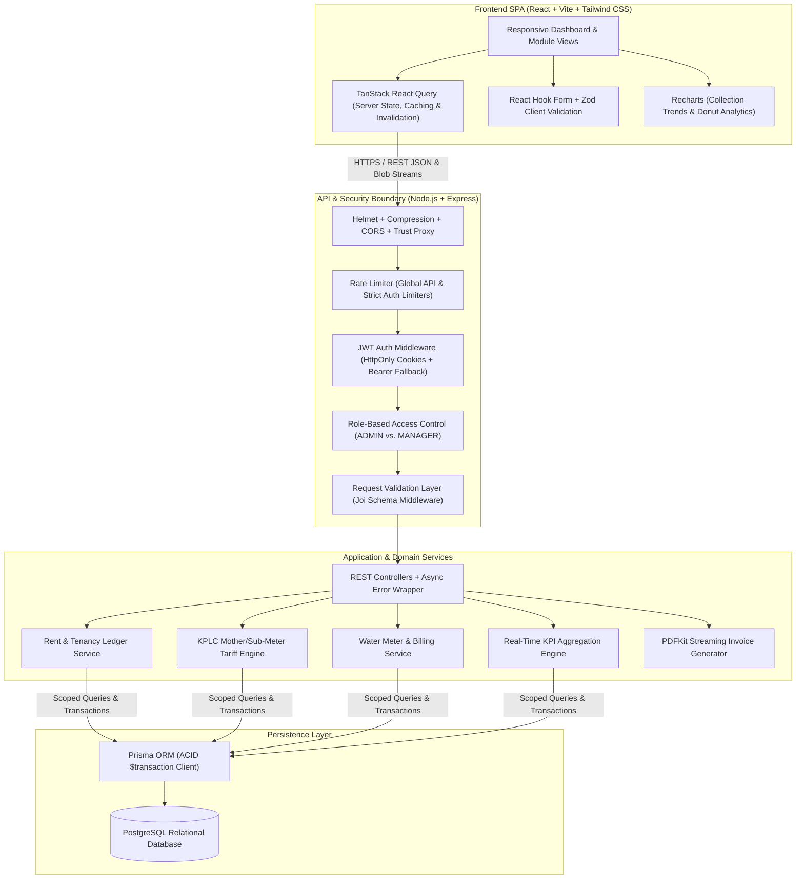

### Technology Stack

| Layer | Technologies Used | Purpose & Architectural Role |
| :--- | :--- | :--- |
| **Frontend UI** | React, Vite, Tailwind CSS, Lucide Icons | Fast SPA rendering, custom design system, print-optimized invoice views (`@media print`). |
| **State & Forms** | TanStack React Query, React Hook Form, Zod, Axios | Declarative data fetching, cache invalidation, request/response interceptors, and schema-driven form validation. |
| **Data Visualization** | Recharts, `date-fns` | 12-month revenue trend line charts, utility collection donut charts, and date manipulation. |
| **Backend Runtime** | Node.js, Express.js | RESTful API server with centralized error handling (`AppError` & Prisma `P2002` constraint mapping). |
| **Database & ORM** | PostgreSQL, Prisma ORM | 16-model relational schema with composite unique constraints, B-tree indexes, and interactive `$transaction` blocks. |
| **Security & Validation** | JWT, `bcrypt`, `cookie-parser`, Joi, `helmet`, `express-rate-limit` | Dual cookie/header JWT authentication, password hashing, strict payload validation, and brute-force protection. |
| **Document Engine** | `PDFKit` | Zero-disk, in-memory PDF statement generation streamed directly to HTTP responses. |
| **DevOps & Infra** | Docker, Docker Compose, Nginx, Vercel | Multi-container orchestration, Nginx SPA routing & reverse proxy, and cloud deployment. |

---

## 🗄️ Database Schema (ERD)

The PostgreSQL schema consists of **16 normalized models** and **6 domain enums** (`HouseStatus`, `Role`, `TenantStatus`, `BillStatus`, `BillingStatus`, `NotificationType`, `NotificationStatus`). It is designed to preserve historical tenancy records while enforcing data integrity via composite unique indexes (e.g., `@@unique([propertyId, houseNumber])` and `@@unique([houseId, billingMonth])`).

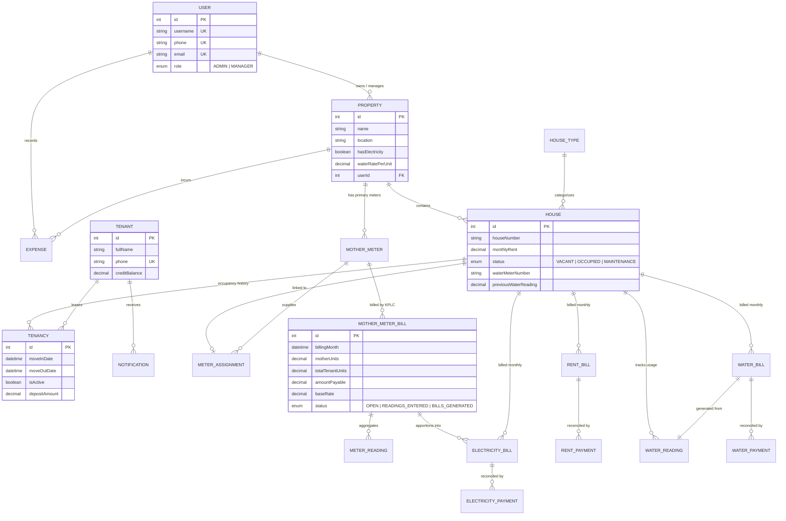

---

## ⚙️ Core Engineering Highlights

### 1. 3-Stage KPLC Mother-Meter to Sub-Meter Tariff State Machine
To ensure landlords recover 100% of their primary KPLC bill without overcharging tenants, the electricity module implements a deterministic state machine (`OPEN` $\rightarrow$ `READINGS_ENTERED` $\rightarrow$ `BILLS_GENERATED`):

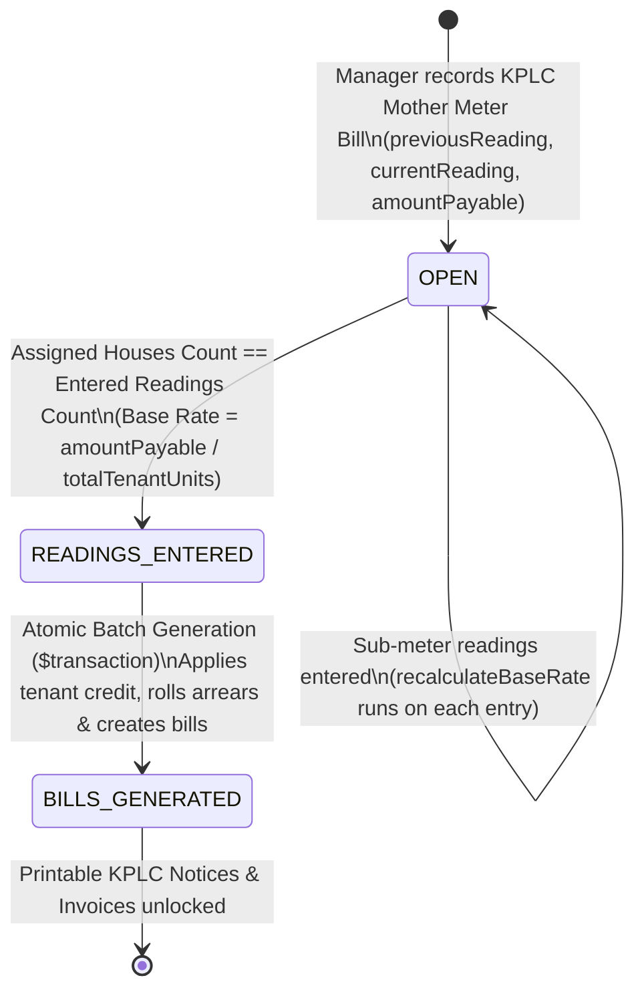

* **Dynamic Rate Recalculation:** Every time a sub-meter reading is created, updated, or deleted, an internal helper (`recalculateBaseRate`) aggregates total units across all sub-meters for that cycle and computes the exact effective tariff:
  $$\text{Effective Base Rate} = \frac{\text{Mother Meter Amount Payable}}{\sum_{i=1}^{n} \text{Tenant Units Used}_i}$$
* **Automatic State Transition:** The service compares `prisma.meterAssignment.count` against `prisma.meterReading.count` for the active cycle. Only when every assigned house has a valid reading (`currentReading >= previousReading`) does the bill unlock the `READINGS_ENTERED` state.
* **Atomic Batch Bill Generation:** Generating individual house electricity bills executes inside an interactive `prisma.$transaction`, ensuring that if any house lacks an active tenant or encounters a constraint error, the entire batch rolls back cleanly.

### 2. Automated Tenant Credit Ledger & Overpayment Engine
Real-world rental payments rarely match invoice totals to the exact shilling. NyumbaFlow implements an automated double-side adjustment mechanism for overpayments and credits:
* **Overpayment Capture:** When a payment is recorded via `rentPayment.service` or `electricityPayment.service`, the engine calculates:
  $$\text{Applied Payment} = \min(\text{Payment Amount}, \text{Remaining Bill Balance})$$
  $$\text{Overpayment} = \text{Payment Amount} - \text{Applied Payment}$$
  If $\text{Overpayment} > 0$, the bill is marked `PAID` (`balance = 0`), and the excess is atomically credited to `Tenant.creditBalance` inside the same database transaction.
* **Auto-Deduction on Next Billing Cycle:** During the next month's batch bill generation, the engine automatically inspects `Tenant.creditBalance`, applies `Math.min(creditBalance, currentCharge + arrears)`, decrements the tenant's remaining credit balance, and records `creditApplied` on the bill for complete auditability.

### 3. Atomic Tenancy Lifecycle (Move-In Automation & Move-Out Write-Offs)
* **Move-In Provisioning (`assignTenant`):** Executes an atomic transaction that creates or links the tenant, verifies no active tenancy collision exists, records the security `depositAmount`, optionally generates and marks the first month's rent bill + payment receipt (`MOVEIN-XXXXXX`), and flips the unit status from `VACANT` to `OCCUPIED`.
* **Move-Out & Debt Write-Off (`moveOutTenant`):** Deactivates the tenancy (`isActive: false`, `moveOutDate: now()`), frees the unit back to `VACANT`, and automatically transitions any remaining unpaid bills to `CANCELLED` so historical bad debt does not pollute active portfolio KPIs.

### 4. Zero-Disk Server-Side PDF Statement Streaming
Instead of writing temporary PDF files to the server filesystem (which introduces I/O bottlenecks and fails on stateless container platforms), `report.controller.js` and `pdf.service.js` stream binary PDF chunks directly to the client using `PDFKit`:
* Aggregates Rent, Electricity (previous/current readings, kWh units, applied rate), and Water usage per occupied house for any selected property and month.
* Pipes `doc.pipe(res)` with `Content-Type: application/pdf` to generate either a single-tenant invoice or a multi-page master PDF containing statements for an entire apartment block in a single HTTP request.

---

## 🧩 Feature Modules

* **📊 Executive Dashboard:**
  * Real-time KPI cards (Rent Collected This Month, Month-over-Month Collection Growth %, Total Outstanding Balance split by Rent/Electricity/Water, Occupancy Rate, Active Tenants, Monthly Expenses).
  * Interactive Recharts **Donut Charts** for Rent, Electricity, and Water collection ratios.
  * **12-Month Collection Trend Line Chart** comparing Rent, Electricity, and Water cashflows across the year.
  * **Action Needed Panel:** Top 5 overdue tenants ranked by total arrears with one-click `tel:` (Call) and `sms:` (Message) triggers.
* **🏘️ Portfolio Management (Properties & Houses):**
  * Multi-property support with configurable per-property settings (`hasElectricity` toggle, custom `waterRatePerUnit`).
  * Categorized unit views (`BedSitter`, `1 Bedroom`, `2 Bedroom`, `Single`, `Shop`) with occupancy badges.
* **👥 Tenant 360° Profile:**
  * Unified ledger view per tenant with dedicated tabs for Rent Bills, Rent Payments, Electricity Bills, Electricity Payments, Water Bills, and Water Payments, scoped strictly to the tenant's active `moveInDate` and `moveOutDate` window.
* **⚡ Electricity Sub-Metering Module:**
  * Mother Meter registry, House-to-Meter assignments, initial reading baselines, monthly KPLC bill ingestion, sub-meter reading entry, automated tenant bill generation, and a specialized **KPLC Printable Bulk Notice View** (`/print/electricity-bills`) formatted with PayBill `888888` / `*977#` instructions.
* **💧 Water Billing Module:**
  * Initial house water meter reading setup, monthly reading entry with automatic `previousWaterReading` roll-forward on the `House` model, bill generation, and payment tracking.
* **🧾 Expenses & Financial Reporting:**
  * Property-level expense logging with daily, monthly, and annual aggregation summaries.
  * **7 Built-in Report Views:** Rent Collection, Electricity Usage, Outstanding Balances, Unified Payment History, Property Occupancy %, Monthly Tenant PDF Statements, and Net Income Financial Summary ($\text{Total Income} - \text{Total Expenses}$).

---

## 📸 Screenshots & Interface Preview

### Product Website

| Landing Page | Product Features | Management Workflow |
| :---: | :---: | :---: |
| 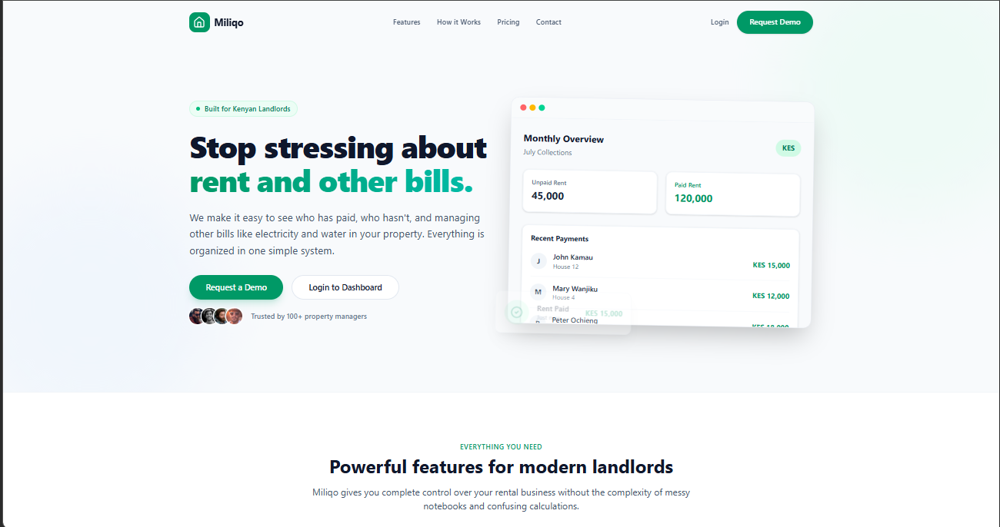 | 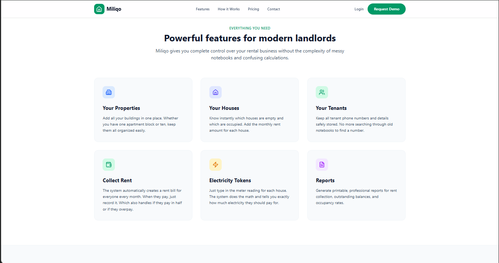 | 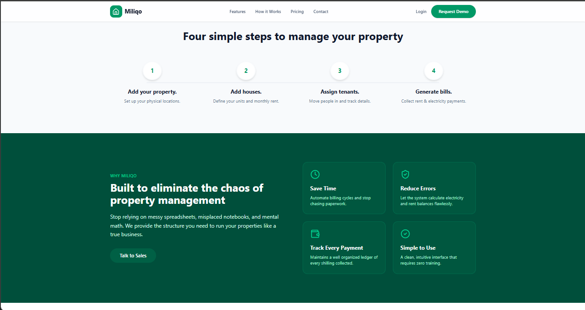 |

### Application Interface

| Executive Dashboard | Analytics Dashboard |
| :---: | :---: |
| 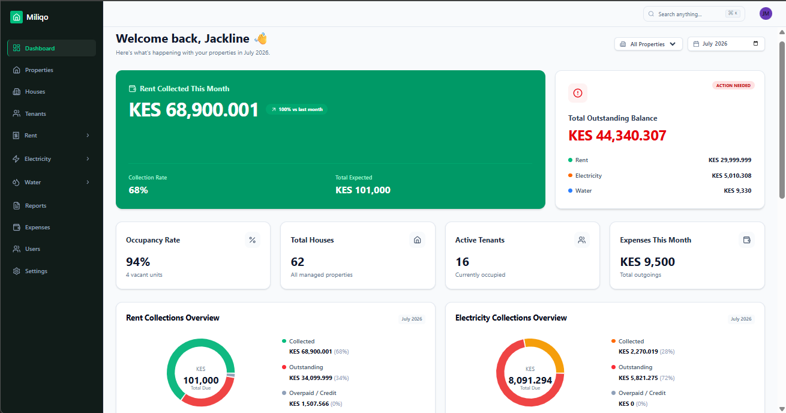 | 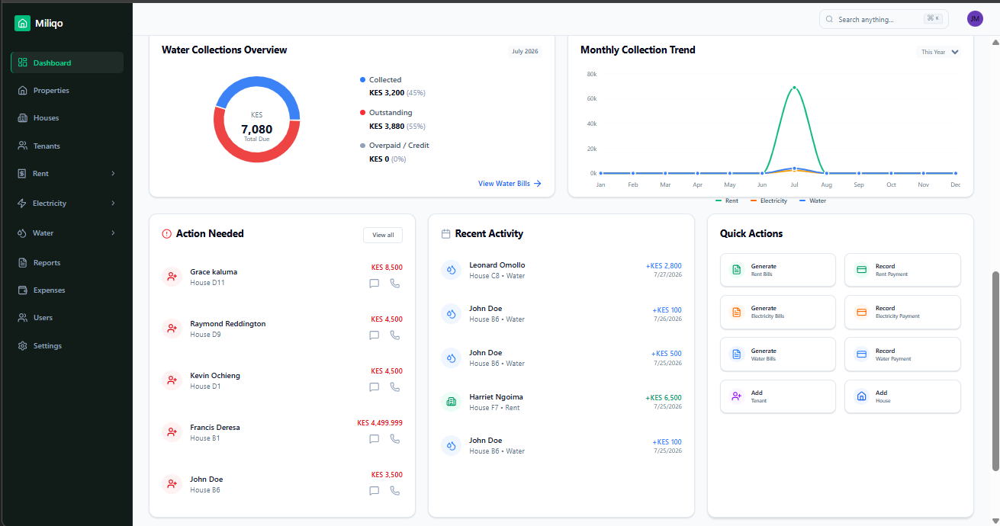 |

| Properties | Houses |
| :---: | :---: |
| 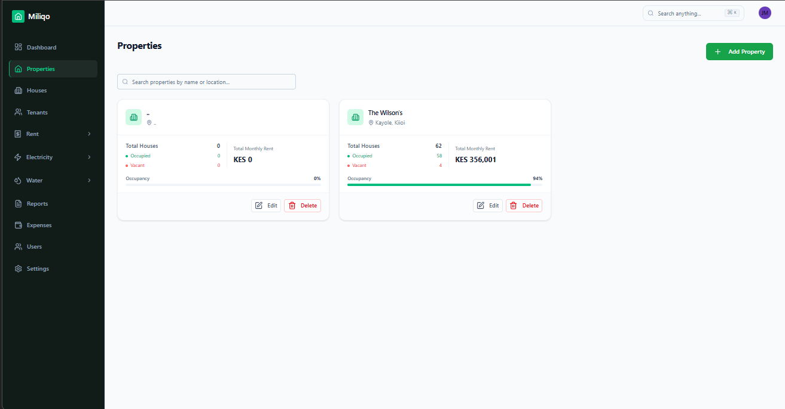 | 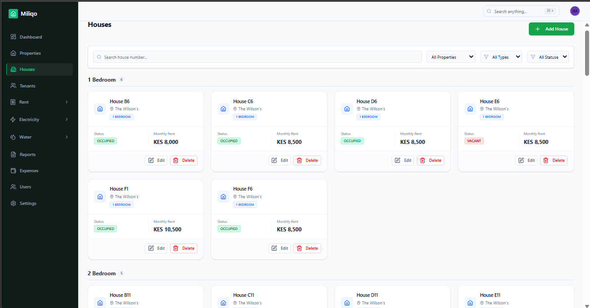 |

| Tenants | Rent Bills |
| :---: | :---: |
| 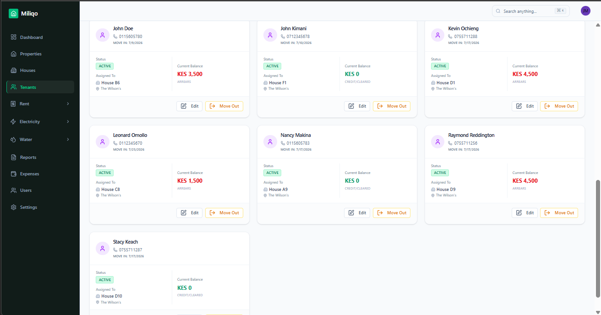 | 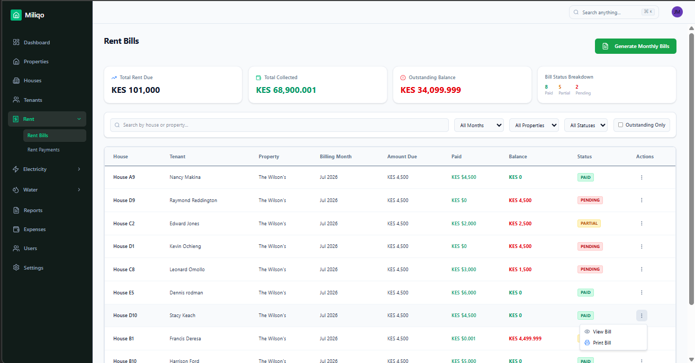 |

| Reports | Monthly Tenant Statement |
| :---: | :---: |
| 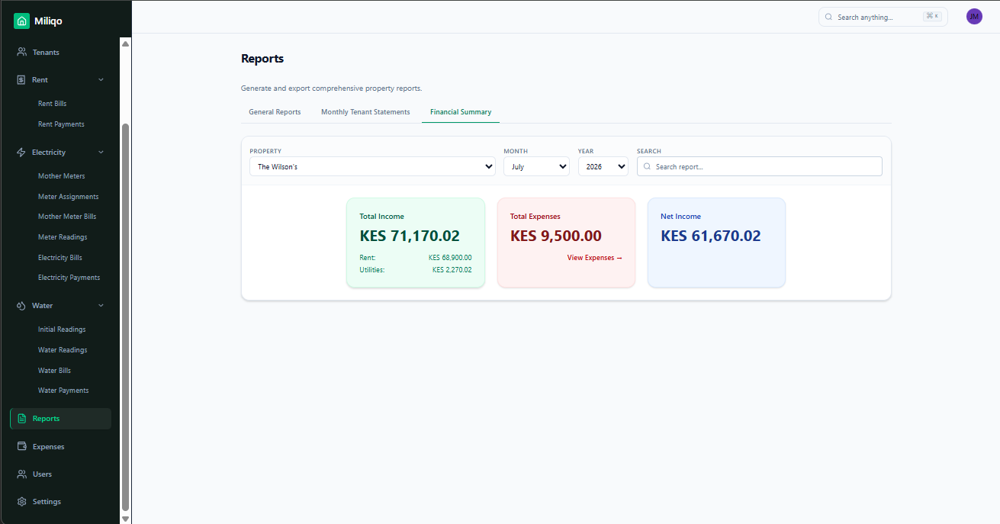 | 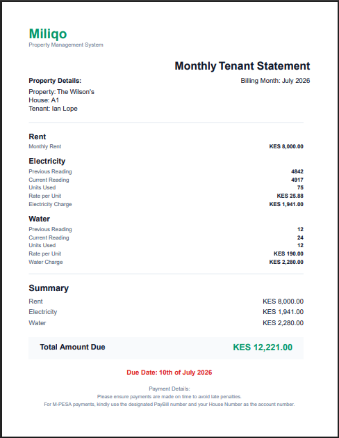 |

| Tenant Ledger | Tenant Payments |
| :---: | :---: |
| 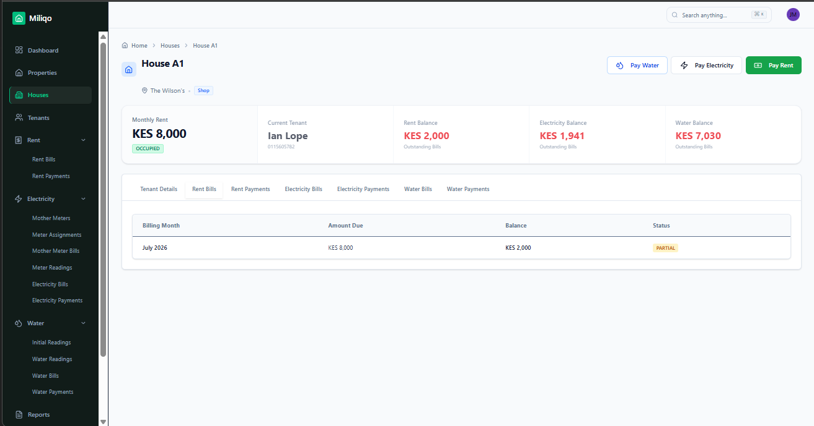 | 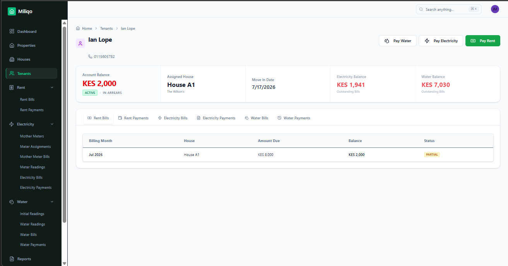 |

---

## 📡 API Reference Overview

The backend exposes **16 modular REST route groups** mounted under `/api`:

| Module | Base Endpoint | Auth / RBAC | Description |
| :--- | :--- | :--- | :--- |
| **Auth** | `/api/auth` | Public / Protected / `ADMIN` | Login (rate-limited to 5 attempts/15m), logout, profile/password update, Admin manager registration. |
| **Users** | `/api/users` | `ADMIN` | List and manage platform managers; self-deletion guard. |
| **Dashboard** | `/api/dashboard` | Protected | Aggregated portfolio KPIs filterable by `selectedMonth` and `propertyId`. |
| **Properties** | `/api/properties` | Protected | CRUD operations for landlord properties and utility rate settings. |
| **Houses** | `/api/houses` | Protected | CRUD for rental units with transactional cascade cleanup. |
| **House Types** | `/api/house-types` | Protected | Unit classification management with foreign-key dependency guards. |
| **Tenants** | `/api/tenants` | Protected | Tenant assignment (`/assign`), profile updates, and atomic `/move-out` workflow. |
| **Rent Bills** | `/api/rent-bills` | Protected | Batch monthly rent generation (`/generate`), house/month filtering, and invoice lookup. |
| **Rent Payments** | `/api/rent-payments` | Protected | Payment receipt recording with automatic overpayment credit allocation. |
| **Mother Meters** | `/api/mother-meters` | Protected | Primary KPLC meter registration and cascading deletion. |
| **Meter Assignments** | `/api/meter-assignments` | Protected | 1-to-1 house-to-mother-meter mapping and baseline reading configuration. |
| **Mother Meter Bills** | `/api/mother-meter-bills` | Protected | Monthly primary KPLC bill logging and consumption tracking. |
| **Meter Readings** | `/api/meter-readings` | Protected | Sub-meter reading ingestion and automatic mother-meter base rate recalculation. |
| **Electricity Bills** | `/api/electricity-bills` | Protected | Batch tenant electricity bill generation (`/generate/:motherMeterBillId`) and management. |
| **Electricity Payments**| `/api/electricity-payments`| Protected | Electricity payment recording and credit balance reconciliation. |
| **Water** | `/api/water` | Protected | Unified endpoints for `/readings`, `/bills`, and `/payments`. |
| **Expenses** | `/api/expenses` | Protected | Property expense CRUD and `/summary` aggregations (Today, Month, Year). |
| **Reports** | `/api/reports` | Protected | Server-streamed PDF tenant statements (`/statements`). |

---

## 🔒 Security & Production Readiness

* **Strict Multi-Tenant Landlord Data Isolation (IDOR Prevention):**  
  Every database query across properties, houses, tenants, meters, bills, and payments scopes ownership to `req.user.id` via relational traversal (`where: { house: { property: { userId } } }`). A manager can never view or mutate another landlord's records by guessing resource IDs.
* **Defense-in-Depth Authentication:**  
  Issues signed JWTs stored in `HttpOnly`, `Secure`, `SameSite` cookies (with `Authorization: Bearer` header support for SPA flexibility) and hashes passwords using `bcrypt` (10 salt rounds).
* **Brute-Force & Abuse Protection:**  
  Configures `express-rate-limit` with a strict limiter on `/api/auth/login` (max 5 requests per 15-minute window per IP) alongside a global API rate limiter, `helmet()` HTTP security headers, and `x-powered-by` header removal.
* **Fail-Fast Environment Bootstrapping:**  
  `server.js` validates all critical environment variables (`DATABASE_URL`, `JWT_SECRET`, `JWT_EXPIRES_IN`, `CLIENT_URL`, `NODE_ENV`, `PORT`) before binding to the port and registers graceful shutdown handlers for `uncaughtException` and `unhandledRejection`.

---

## 📬 Contact & Codebase Walkthrough

I architected and built **NyumbaFlow (Miliqo)** end-to-end—from relational database design and transactional billing services to the React/Tailwind frontend and Dockerized deployment.

If you are a **technical recruiter, hiring manager, or engineering lead** interested in:
* A live screen-share walkthrough of the private repository and business logic
* Discussing the architectural trade-offs and utility billing state machines
* Full-stack, backend, or frontend software engineering opportunities

**Let's connect:**
* 👤 **Engineer:** Ian Wabacha Kimani
* 🌐 **Live Application:** [nyumba-flow-snowy.vercel.app](https://nyumba-flow-snowy.vercel.app)
* 🐙 **GitHub:** [@ian-kimani](https://github.com/ian-kimani)
* 💼 **LinkedIn:** [(https://www.linkedin.com/in/ian-wabacha)]
* 📧 **Email:** [kimaniian273@gmail.com]

---

  
<em>Designed & Engineered by <strong>Ian Wabacha Kimani</strong> • © 2026 All Rights Reserved</em>

